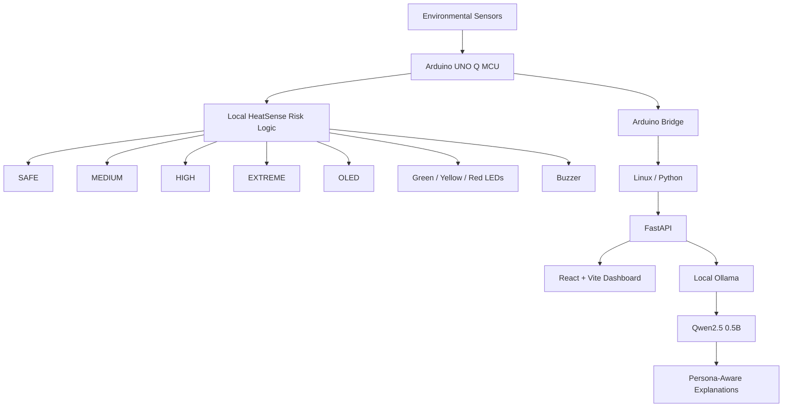
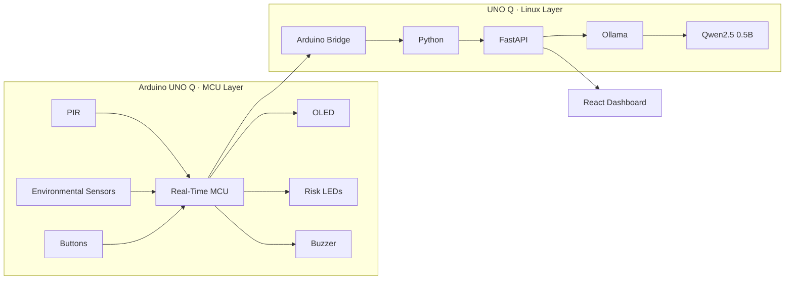
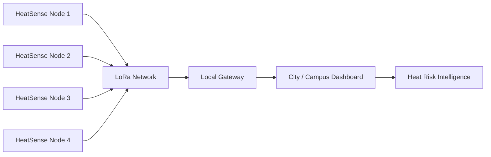

<div align="center">

# 🌡️ HeatSense Edge

<a href="https://git.io/typing-svg">
  
</a>

### BPUT Hackathon 2026

**Team BITBYBIT · BH26PS02T015**

<br>


<br>

> **HeatSense Edge is an offline-capable intelligent heat-safety system that combines environmental sensing, real-time local risk awareness, physical alerts, a live dashboard, and local conversational AI on Arduino UNO Q.**

</div>

---

# 🚀 The Problem

Extreme heat is becoming an increasing safety concern in classrooms, workplaces, factories, homes, construction environments and public spaces.

Most conventional systems only display temperature.

They often do not combine:

- environmental context
- occupancy
- activity
- local risk awareness
- personalized guidance
- offline operation
- immediate physical alerts

**HeatSense Edge is designed to bridge that gap.**

---

# 💡 Our Solution

HeatSense Edge combines:

```text
Environmental Sensors
        ↓
Arduino UNO Q MCU
        ↓
Local HeatSense Risk Layer
        ↓
SAFE / MEDIUM / HIGH / EXTREME
        ↓
┌──────────────┬──────────────┬──────────────┐
│ OLED Display │ Risk LEDs    │ Buzzer Alert │
└──────────────┴──────────────┴──────────────┘
        ↓
Arduino Bridge
        ↓
Python + FastAPI
        ↓
React Dashboard
        ↓
Local Ollama AI Assistant
```

The important design principle is:

> **The LLM does not make the safety decision.**

The local HeatSense hardware/risk layer remains authoritative.

Ollama is used as the **conversational explanation and guidance layer**.

---

# 🧠 Edge AI Architecture



---

# ⚡ Why Arduino UNO Q?

Arduino UNO Q allows HeatSense Edge to combine two different computing worlds.

### Real-Time MCU Side

Responsible for:

- sensor communication
- PIR occupancy detection
- buttons
- OLED
- risk LEDs
- buzzer
- real-time hardware behavior

### Linux Side

Responsible for:

- Python
- FastAPI
- REST APIs
- Arduino Bridge communication
- local Ollama inference
- dashboard communication
- AI assistant

This gives HeatSense both:

**real-time embedded control + Linux edge computing**

on one platform.

---

# 🧩 Current Hardware

| Hardware | Purpose | Status |
|---|---|---|
| Arduino UNO Q | Main Edge AI platform | ✅ Working |
| PIR Sensor | Occupancy detection | ✅ Working |
| 0.96" OLED | Local system display | ✅ Working |
| Green LED | SAFE indication | ✅ Working |
| Yellow LED | MEDIUM indication | ✅ Working |
| Red LED | HIGH / EXTREME indication | ✅ Working |
| Active Buzzer | Audible warning | ✅ Working |
| Persona Button | Persona selection | ✅ Working |
| Risk Button | Prototype risk-state simulation | ✅ Working |
| BME688 | Temperature / humidity / pressure | 🔧 Integration |
| BH1750 | Light exposure context | 🔧 Integration |
| DS18B20 | Temperature sensing | 🔧 Integration |
| MPU6050 | Motion / activity context | 🔧 Integration |
| 12V 4010 Fan | Cooling actuator | 🧪 Planned |
| LoRa SX1278 | Multi-node communication | 🔮 Future |

---

# 🚦 Physical Risk System

HeatSense communicates risk visually and audibly.

| Risk | LED | Buzzer |
|---|---|---|
| 🟢 SAFE | Green | Off |
| 🟡 MEDIUM | Yellow | Short alert |
| 🔴 HIGH | Red | Multiple warning beeps |
| 🚨 EXTREME | Red flashing | Urgent alert sequence |

Current prototype states:

```text
SAFE
  ↓
🟢 Green

MEDIUM
  ↓
🟡 Yellow
  ↓
Short Beep

HIGH
  ↓
🔴 Red
  ↓
Warning Beeps

EXTREME
  ↓
🔴 Flashing Red
  ↓
Urgent Buzzer
```

---

# 👥 Persona-Aware Guidance

HeatSense supports four user personas.

```text
GENERAL
WORKER
ELDERLY
CHILD
```

The persona changes **how advice is communicated**, not the authoritative risk state.

### 👤 General

Clear general heat-safety guidance.

### 👷 Worker

Focuses on:

- workload
- cooling breaks
- hydration
- rest
- safe return to strenuous activity

### 👴 Elderly

Focuses on:

- calm guidance
- cooling
- hydration
- avoiding prolonged heat exposure
- assistance when appropriate

### 🧒 Child

Uses simpler guidance emphasizing:

- cooler environments
- drinking water
- reducing strenuous activity
- responsible adult supervision

---

# 🤖 Local Offline AI

HeatSense runs:

```text
Ollama
   ↓
Qwen2.5:0.5B
```

locally on the Arduino UNO Q Linux environment.

### AI responsibilities

The AI can:

- explain HeatSense
- explain current system state
- explain personas
- explain architecture
- provide persona-aware guidance
- answer project-related questions

The AI does **not** independently control:

- risk classification
- LEDs
- buzzer
- OLED
- fan
- physical actuators

This separation improves reliability for a safety-oriented system.

---

# 🛡️ Anti-Hallucination Design

HeatSense uses a hybrid architecture.

```text
Question
   ↓
Is the answer already known from live hardware?
   │
   ├── YES
   │      ↓
   │  Deterministic verified response
   │
   └── NO
          ↓
       Ollama
          ↓
   Grounded system prompt
          ↓
     AI explanation
```

If Ollama temporarily fails:

```text
Ollama Request
     ↓
Retry
     ↓
Still unavailable?
     ↓
Verified Local HeatSense Fallback
```

The interface therefore avoids relying on hallucinated sensor values.

---

# 🌐 Live API

FastAPI exposes the current HeatSense state.

## Status

```http
GET /api/status
```

Example:

```json
{
  "occupancy": "OCCUPIED",
  "persona": "WORKER",
  "risk": "HIGH",
  "bridge_connected": true
}
```

Supported values:

### Risk

```text
SAFE
MEDIUM
HIGH
EXTREME
```

### Persona

```text
GENERAL
WORKER
ELDERLY
CHILD
```

### Occupancy

```text
OCCUPIED
EMPTY
```

---

# 🤖 AI Status API

```http
GET /api/ai/status
```

Example:

```json
{
  "online": true,
  "mode": "OFFLINE_LOCAL",
  "provider": "Ollama",
  "model": "qwen2.5:0.5b",
  "model_available": true
}
```

---

# 💬 Ask HeatSense API

```http
POST /api/chat
```

Request:

```json
{
  "message": "Explain how HeatSense works."
}
```

Example response:

```json
{
  "response": "HeatSense combines real-time hardware monitoring with local edge processing and an offline conversational AI layer.",
  "mode": "offline_ai",
  "provider": "Ollama",
  "model": "qwen2.5:0.5b"
}
```

---

# 🖥️ Dashboard

The React dashboard provides:

- live occupancy
- selected persona
- risk state
- Arduino Bridge status
- hardware status
- risk visualization
- AI assistant
- system architecture
- multilingual interface
- interactive educational experiences
- responsive mobile/desktop experience

The dashboard updates live without requiring a page refresh.

---

# ✨ Animated Hardware Story

The frontend presents HeatSense through a seven-stage visual experience.

It uses:

- GSAP
- ScrollTrigger
- Framer Motion
- custom SVG graphics
- animated signal paths
- responsive transitions
- scroll-driven storytelling

The Arduino UNO Q remains visually central while the viewer learns how each part of the system works.

---

# 🎮 Interactive Experiences

The project also includes interactive educational experiences designed to demonstrate HeatSense concepts.

Examples include:

- Heat Risk Predictor
- Cool the Room
- Persona Protector
- Sensor Detective
- Signal Router
- Heatwave Commander

Simulated game values are kept separate from actual device readings.

---

# 🌍 Languages

The interface supports:

```text
🇬🇧 English
🇮🇳 Hindi
🇮🇳 Odia
```

Primary navigation, system states, controls and user-facing dashboard content support localization.

---

# 🛠️ Technology Stack

<div align="center">

| Layer | Technology |
|---|---|
| Hardware | Arduino UNO Q |
| MCU Programming | Arduino / C++ |
| Device Communication | Arduino Bridge |
| Edge Computer | UNO Q Linux |
| Backend | Python |
| API | FastAPI |
| Local AI | Ollama |
| LLM | Qwen2.5:0.5B |
| Frontend | React |
| Build Tool | Vite |
| Animation | GSAP + ScrollTrigger |
| Motion UI | Framer Motion |
| Charts | Recharts |
| Icons | Lucide React |

</div>

---

# 🧱 System Architecture



---

# 📁 Recommended Repository Structure

```text
HeatSense-Edge/
│
├── arduino-app/
│   ├── sketch/
│   │   └── sketch.ino
│   │
│   ├── python/
│   │   ├── main.py
│   │   └── requirements.txt
│   │
│   └── app.yaml
│
├── frontend/
│   ├── src/
│   │   ├── components/
│   │   ├── hooks/
│   │   ├── services/
│   │   ├── App.jsx
│   │   └── main.jsx
│   │
│   ├── public/
│   ├── package.json
│   ├── vite.config.js
│   └── .env.example
│
├── screenshots/
│
├── docs/
│
├── README.md
└── .gitignore
```

---

# ▶️ Running the Frontend

Requirements:

```text
Node.js 22+
npm
```

Install:

```bash
npm install
```

Create environment file:

### Linux / macOS

```bash
cp .env.example .env
```

### Windows PowerShell

```powershell
Copy-Item .env.example .env
```

Start development server:

```bash
npm run dev
```

Normally available at:

```text
http://127.0.0.1:5173
```

---

# 🔗 Connect to HeatSense Backend

During development, the Vite proxy connects the frontend to FastAPI.

FastAPI:

```text
http://127.0.0.1:8000
```

Example Vite configuration:

```javascript
server: {
  host: "127.0.0.1",
  port: 5173,

  proxy: {
    "/api": {
      target: "http://127.0.0.1:8000",
      changeOrigin: true,
      secure: false
    }
  }
}
```

Frontend requests can therefore use:

```javascript
fetch("/api/status")
```

instead of hard-coding the backend address throughout the UI.

---

# 🧪 Testing

Frontend:

```bash
npm test
```

Build:

```bash
npm run build
```

Preview:

```bash
npm run preview
```

Test FastAPI:

```bash
curl http://localhost:8000/api/status
```

Test through Vite:

```bash
curl http://127.0.0.1:5173/api/status
```

---

# ✅ Prototype Status

## Working

```text
✅ Arduino UNO Q
✅ MCU firmware
✅ OLED display
✅ PIR occupancy detection
✅ Green risk LED
✅ Yellow risk LED
✅ Red risk LED
✅ Active buzzer
✅ Persona button
✅ Risk-state test button
✅ Arduino Bridge
✅ Linux / Python
✅ FastAPI
✅ GET /api/status
✅ GET /api/ai/status
✅ POST /api/chat
✅ Local Ollama
✅ Qwen2.5:0.5B
✅ React / Vite dashboard
✅ Live hardware status
✅ Persona-aware AI guidance
```

## Hardware Integration In Progress

```text
🔧 BME688
🔧 BH1750
🔧 DS18B20
🔧 MPU6050
```

## Future Expansion

```text
🔮 Automatic multi-sensor risk classification
🔮 Fan actuation
🔮 Airflow monitoring
🔮 Heat-condition prediction
🔮 LoRa multi-node networking
🔮 Optional cloud AI enhancement
```

---

# 🔒 Safety Architecture

HeatSense follows one important rule:

```text
LLM ≠ Safety Controller
```

Instead:

```text
Sensors
   ↓
MCU / Local Risk Logic
   ↓
Authoritative Risk State
   ↓
Physical Alerts
   ↓
Dashboard
   ↓
AI Explanation
```

This allows conversational AI to improve usability without giving an LLM direct authority over safety-critical hardware.

---

# 🌟 Key Innovation

HeatSense Edge is not simply a temperature-monitoring project.

It combines:

**Multi-sensor context + real-time hardware + local Edge AI + persona-aware interaction + offline operation + physical warnings**

on an Arduino UNO Q platform.

Its architecture separates:

```text
SENSING
   ↓
DECISION
   ↓
ACTUATION
   ↓
EXPLANATION
```

making the design easier to understand, test and expand.

---

# 🎯 Target Applications

HeatSense Edge can potentially be adapted for:

- factories
- schools
- workshops
- warehouses
- construction environments
- offices
- homes
- public buildings
- heat-sensitive workspaces
- smart-city safety networks

---

# 🔭 Future Vision



The long-term vision is to expand HeatSense from a single-room prototype into a distributed network of local heat-safety nodes.

---

# 📸 Screenshots

Add project screenshots inside:

```text
screenshots/
```

Then display them here:

```html
<p align="center">
  
</p>
```

You can also add:

```html
<p align="center">
  
  
</p>
```

---

# 🎥 Demo

### Project Demo Video

[](YOUR_VIDEO_URL)

---

# 💻 Source Code

### GitHub Repository

[](YOUR_GITHUB_URL)

---

# 🏆 BPUT Hackathon 2026

<div align="center">

### Team BITBYBIT

**Project:** HeatSense Edge

**Team ID:** `BH26PS02T015`

<br>

### 🌡️ Cooler Rooms.
### 🛡️ Safer People.
### 🌆 Smarter Cities.

<br>

Built with ❤️ using **Arduino UNO Q + Edge AI**

</div>

---

## ⚠️ Prototype Notice

HeatSense Edge is currently a hackathon prototype.

It is intended to demonstrate edge computing, environmental sensing, local risk awareness and AI-assisted interaction.

It should not be treated as a certified medical, occupational-safety or meteorological instrument.

---

<div align="center">

<a href="#-heatsense-edge">⬆ Back to Top</a>

<br><br>

**HeatSense Edge · Team BITBYBIT · BPUT Hackathon 2026**

</div>
